<h2 data-importer="text" align="left">Hi 👋! My name is Lucas Abel and I'm a  Full-Stack Developer & Game Developer, from Portugal</h2>

###

  
  

###

###

  
  
  
  
  
  
  
  
  
  
  
  
  

###

  
  

###

 

###
